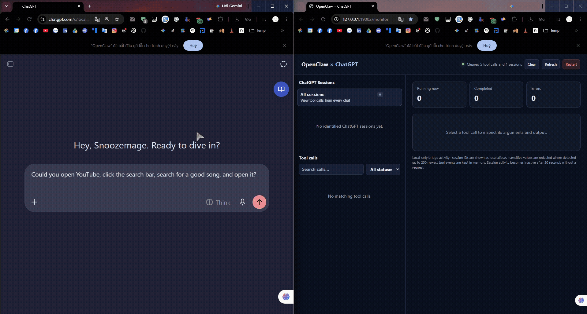
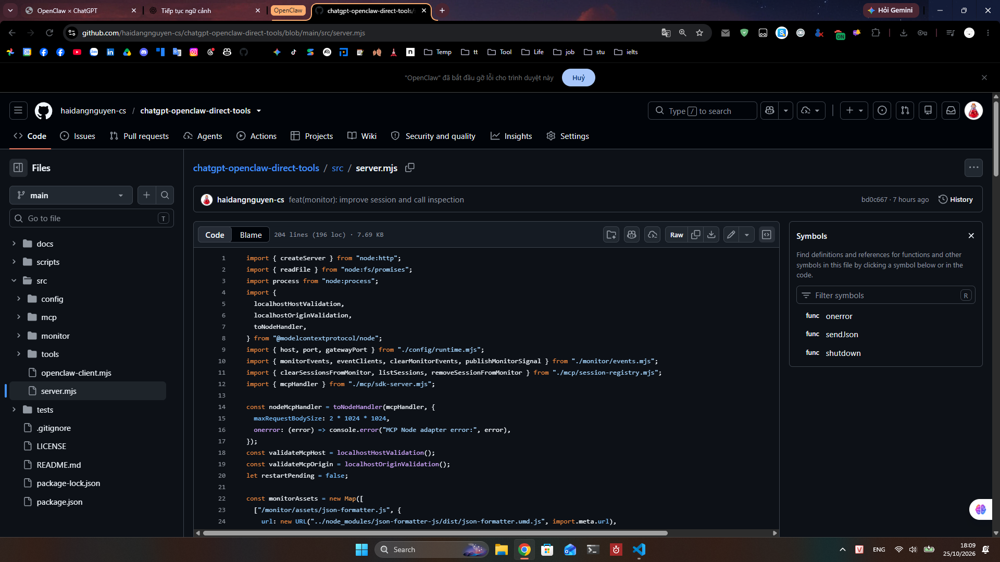
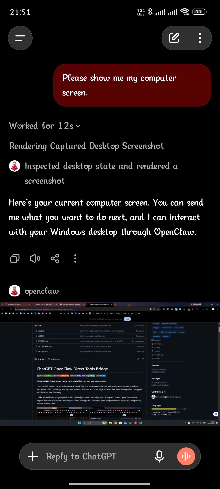
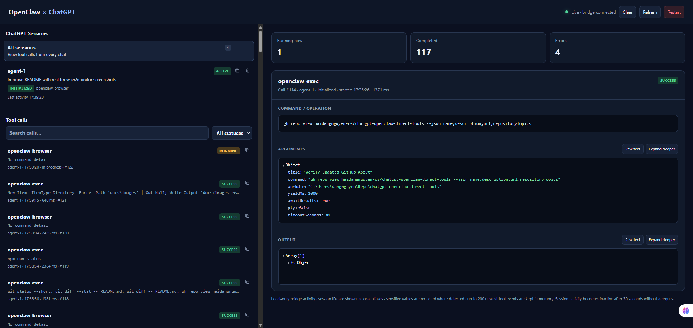
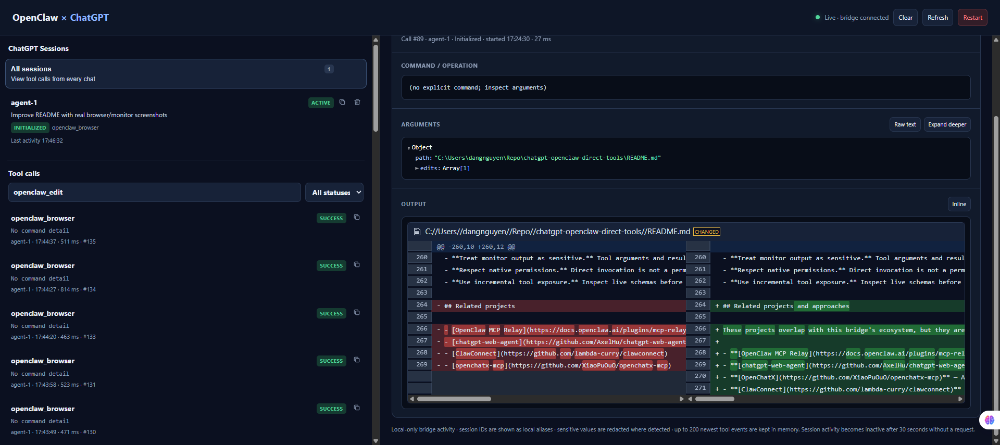

# OpenClaw Direct Tools for ChatGPT

[](https://nodejs.org/)
[](https://openclaw.ai/)
[](https://modelcontextprotocol.io/)
[](https://chatgpt.com/)
[](LICENSE)
[](https://aiagentslisting.com/mcp/chatgpt-openclaw-direct-tools)
[](https://m8ven.ai/mcp/snoozemage-openclaw-direct-tools-for-chatgpt-1my28a?s=readme)

**Give ChatGPT direct access to the tools available in your OpenClaw runtime.**

**Platform status:** Windows is the currently tested setup. Linux and macOS support has not yet been validated. Contributions and testing reports for additional platforms are welcome. See [Contributing](CONTRIBUTING.md).

Use ChatGPT to work on a local codebase: search files, inspect implementations, edit code, run commands and tests, and review diffs. The bridge also exposes browser, desktop, and other eligible OpenClaw tools through direct wrappers and dynamic tool discovery.

Unlike a fixed list of bridge-specific tools, the bridge can discover eligible tools in your current OpenClaw runtime, inspect their actual schemas, and dispatch them through the Gateway. OpenClaw permissions, approvals, and policies remain authoritative.



*Browser automation through the bridge.*

## Capabilities

| Area | Public tools | What they provide |
|---|---|---|
| Session setup | `start_here` | Must be called once before other bridge tools in each ChatGPT conversation; loads tool-routing and safety instructions. |
| Browser automation | `openclaw_browser` | Chrome status and lifecycle, tabs, navigation, snapshots, screenshots, page interaction, text, console/network diagnostics, downloads, uploads, dialogs, PDF, and supported emulation. |
| Desktop automation | `openclaw_computer` | Windows screen snapshots, mouse and keyboard input, window/app operations, accessibility queries, and bounded action batches. |
| File operations | `openclaw_ls`, `openclaw_read`, `openclaw_edit`, `openclaw_write`, `openclaw_apply_patch` | List, read, edit, create/replace, and patch files through OpenClaw's native file tools. Listing and reading support batches. |
| Local project search | `openclaw_glob`, `openclaw_grep` | Discover paths and search file contents using Node.js glob and ripgrep, without a shell for the search itself. |
| Runtime operations | `openclaw_exec`, `openclaw_process` | Run commands and inspect or control processes started through the runtime wrapper. |
| Screenshot presentation | `openclaw_image_render` | Display a recent desktop screenshot in the ChatGPT UI using a short-lived reference. |
| Native tool discovery | `openclaw_tool_search`, `openclaw_tool_describe`, `openclaw_dispatch_action` | Find eligible tools in the current OpenClaw runtime, inspect their actual schemas, and invoke tools that do not already have a direct bridge wrapper. |

This catalog describes the bridge's public interface, not a guarantee that every native OpenClaw capability is available in every installation. Runtime version, installed plugins, node hardware, pairing approvals, Gateway policy, and operating-system permissions all affect availability.

## Quick Start

> **Note:** The steps below are for Windows; Linux and macOS have not yet been validated.

The shortest path to trying the bridge:

1. **Prepare OpenClaw and the tunnel.** Make sure OpenClaw is installed and configured. Create an OpenAI Secure MCP Tunnel, associate it with your target ChatGPT workspace, and have a Platform API key with **Tunnels Read + Use** permission ready. See [Prepare the OpenAI tunnel](#prepare-the-openai-tunnel) for details.
2. **Clone and configure** in Windows PowerShell:

   ```powershell
   git clone https://github.com/Snoozemage/openclaw-direct-tools-for-chatgpt.git
   Set-Location openclaw-direct-tools-for-chatgpt
   npm run setup
   ```

   Follow the setup wizard to configure your local OpenClaw paths, ports, tunnel ID, and API key.
3. **Start the bridge:**

   ```powershell
   npm start
   npm run status
   ```

4. **Connect ChatGPT.** Add a custom MCP server using the **Tunnel** connection, select the same tunnel, then open a conversation and select the plugin. The local call monitor is available at [http://127.0.0.1:19002/monitor](http://127.0.0.1:19002/monitor) with the default port.

For the full setup flow, workspace requirements, troubleshooting notes, and lifecycle details, continue to [Setup and operation](#setup-and-operation).

## Architecture

The bridge provides the MCP endpoint, routes calls to feature-specific handlers, and hosts a local call monitor. Depending on the capability, a handler uses an OpenClaw native tool, invokes a Gateway tool, or performs bridge-owned work.

```text
ChatGPT custom MCP connector
          |
OpenAI Secure MCP Tunnel
          |
Local Node.js bridge
  ├── MCP endpoint (/mcp)
  │     └── Public tool registry and dispatcher
  │           ├── Browser wrapper ──────────> OpenClaw Gateway ──> Browser / Chrome extension
  │           ├── Desktop wrapper ──────────> OpenClaw Gateway / paired computer node
  │           ├── Files and runtime wrappers > OpenClaw native tools
  │           ├── Tool Discovery ───────────> Effective tool catalog / Gateway invocation
  │           └── Bridge-native utilities ──> glob, grep, screenshot rendering, session setup
  └── Local call monitor (/monitor)
        └── In-memory events and Server-Sent Events (/events)
```

Tool definitions are assembled in `src/mcp/tool-definitions.mjs`; `src/mcp/tool-dispatcher.mjs` routes public tool names to handlers. The local HTTP server exposes `/mcp` and `/healthz` as well as the monitor endpoints. Tool-call events are streamed to the monitor over Server-Sent Events (SSE).

### Integration boundaries

- **OpenClaw wrappers:** Browser, Computer, Files, and runtime execution/process tools use OpenClaw's native behavior for the operation they wrap. The bridge may shape the public schema, prepare arguments, maintain interaction state, or format results, but it does not bypass OpenClaw policy.
- **Bridge-native utilities:** `openclaw_glob` and `openclaw_grep` search local files; `openclaw_image_render` presents a screenshot captured by the computer tool; `start_here` supplies conversation-specific routing instructions.
- **Dynamic tool discovery:** the discovery trio searches tools effectively available to the configured OpenClaw agent, returns runtime-provided schemas, and dispatches the exact selected tool through the supported Gateway invocation path. Tools already covered by direct wrappers are intentionally excluded so their bridge-specific behavior is retained.

For implementation guidance, see [Tool Exposure Guide](docs/TOOL_EXPOSURE_GUIDE.md). For node command policy and discovery of capabilities such as camera, location, screen, device information, notifications, and plugin-provided actions, see [Gateway Node Command Reference](docs/GATEWAY_NODE_COMMAND_REFERENCE.md).

## Setup and operation

### Requirements

- Current setup and lifecycle scripts are written for **Windows/PowerShell**. The MCP server is built with Node.js, but setup and lifecycle support on other operating systems has not yet been validated.
- Node.js **22.17 or later** and npm.
- `rg.exe` (ripgrep) on `PATH`, or set `OPENCLAW_RIPGREP_PATH` to its executable path.
- An installed and configured OpenClaw runtime and Gateway.
- An OpenAI Secure MCP Tunnel created in Platform and an **OpenAI Platform API key for `tunnel-client`** with Tunnels Read + Use permission. You also need a ChatGPT account/workspace that can add a custom MCP server. The project maintainer has verified that this bridge connects successfully on a **ChatGPT Free** account.

### Prepare the OpenAI tunnel

1. Open [OpenAI Platform Tunnels settings](https://platform.openai.com/settings/organization/tunnels) and create a Secure MCP Tunnel. Note its `tunnel_id` and associate the tunnel with the ChatGPT workspace where the connector will be created. A tunnel attached only to a Platform organization may not appear in a separate ChatGPT workspace.
2. Create or select an **OpenAI Platform API key** for the tunnel client. This key authenticates `tunnel-client` to OpenAI's tunnel control plane; it is required even though the MCP bridge itself runs locally. Grant it **Tunnels Read + Use** so it can run the tunnel and select it for the ChatGPT connection. Creating or editing the tunnel requires **Tunnels Read + Manage** for the account performing that operation.
3. The API key for `tunnel-client` is separate from your ChatGPT sign-in and from the authentication setting on the ChatGPT custom MCP plugin. The setup wizard prompts for the key using hidden input and stores it in a user-restricted local file. Do not paste it into ChatGPT, put it in the repository, or commit it to Git.

See the official [Secure MCP Tunnel guide](https://developers.openai.com/api/docs/guides/secure-mcp-tunnels) for organization/workspace associations and permissions.

### Configure the bridge

From the repository root, run the setup wizard in PowerShell:

```powershell
npm run setup
```

Follow the prompts for the OpenClaw config and CLI paths, Node.js, bridge and Gateway ports, the `tunnel_id`, and runtime API-key material. Setup installs the locked npm dependencies, locates or downloads the official `tunnel-client`, creates a profile that forwards the tunnel to the bridge's local `/mcp` endpoint, validates the configuration, and stores generated settings outside the repository.

The default local application directory is:

```text
%LOCALAPPDATA%\OpenClawChatGPTBridge\
```

It contains the generated configuration, tunnel profile, and runtime logs. The tunnel runtime API key is stored in Windows Credential Manager and is not written to a plaintext key file by the current setup flow. Keep generated configuration, profiles, and logs out of version control.

On existing installations, rerun `npm run setup` once to migrate the old key file. Setup verifies the Credential Manager entry before removing that file. Normal file deletion cannot guarantee secure erasure of historical disk copies; rotate the key if you suspect prior exposure.

### Start, inspect, and stop

```powershell
npm start
npm run status
npm stop
```

The Windows scripts manage the bridge, tunnel client, and Gateway startup as configured. The stop script only stops a Gateway process when the project launcher started it and the recorded PID still matches the expected command; it leaves a pre-existing Gateway process running.

The bridge normally listens on `http://127.0.0.1:19002` and the Gateway on port `19001`; configured values may differ. Open the local call monitor at `http://127.0.0.1:19002/monitor`. Keep the tunnel client running while ChatGPT discovers or calls tools; use `npm run status` to inspect the local stack.

### Add the bridge in ChatGPT

1. In ChatGPT on the web, open **Plugins**, select **+**, then choose **Add custom MCP server**.
2. Enter a name and optional description. Under **Connection**, choose **Tunnel**, then select the same Secure MCP Tunnel created earlier (or enter its `tunnel_id` if prompted). Do not paste the local `http://127.0.0.1:19002/mcp` address into **Server URL** when using the tunnel connection.
3. Configure authentication if the connection form requires it, review the risk warning, acknowledge it, and choose **Create as a plugin**.
4. Review the discovered tool list and metadata. Install the resulting plugin, start a new conversation, type `@`, select the plugin, and test a low-risk operation.

Adding the plugin is separate from running the local bridge and tunnel client. If the tunnel is not listed, verify that it is associated with the target ChatGPT workspace and that your Platform account has Tunnels Read + Use. The project maintainer has successfully connected this bridge using ChatGPT Free. See the [ChatGPT custom MCP server guide](https://help.openai.com/en/articles/12584461-connecting-custom-mcp-servers-in-chatgpt) for details.

For Windows sign-in startup, `scripts/windows/start-on-logon.ps1` is the scheduled-task entry point. `scripts/windows/bridge-supervisor.ps1` supervises bridge restarts. `scripts/windows/start-monitor.ps1` is retained as a compatibility alias for the combined launcher.

## Tool behavior and boundaries

### Browser

`openclaw_browser` forwards supported Browser actions through the Gateway. Profile-dependent actions are pinned internally to `profile: "chrome"`; the public schema does not expose profile selectors. When Chrome is fully closed, `action: "open"` can launch it using the existing local Chrome User Data directory and its last-used profile. The OpenClaw extension must already be installed in that profile and able to connect. Other actions do not launch Chrome automatically, and an already-running Chrome instance is left running.

Example: the Browser tool opened this public repository, navigated into `src/`, and opened `server.mjs` for inspection.



For page interaction, take a fresh snapshot and use its element references where appropriate. The `action: "act"` batch mode combines predictable steps into one native `/act` request; `open`, `navigate`, `snapshot`, and `screenshot` remain separate calls. Page-changing actions can invalidate references, so observe the page again before dependent actions. A batch stops on the first failed step by default; `stopOnError: false` continues. If the runtime rejects a batch, execute the steps individually.

The bridge supplies a 10-second default timeout for `action: "open"` when none is provided. If an open operation times out, it checks the current tab list once and reports success only if the requested URL is observed; it does not retry automatically. URL schemes, action support, browser availability, extension attachment, and permissions remain controlled by OpenClaw and the browser runtime.

OpenClaw's browser SSRF policy also applies to local URLs. If `browser.ssrfPolicy.allowedHostnames` is explicitly configured, `localhost` and `127.0.0.1` must be listed separately when both forms are needed. For this monitor, retain both entries if using both URL forms:

```json5
{
  browser: {
    ssrfPolicy: {
      allowedHostnames: ["localhost", "127.0.0.1"]
    }
  }
}
```

This is OpenClaw configuration, not a bridge setting. Add only trusted, specific hostnames. Do not enable `dangerouslyAllowPrivateNetwork` just to fix a loopback URL. See the [OpenClaw browser configuration](https://docs.openclaw.ai/tools/browser/configuration) and [browser security guidance](https://docs.openclaw.ai/gateway/security/browser-control).

### Desktop

`openclaw_computer` controls desktop UI through the configured paired computer node; it does not interact with the browser DOM. Take a `snapshot` first, reuse its `executionId`, and pass its latest `displayFrameId` for coordinate-based actions. Capture a fresh snapshot after screen/layout changes. Batch mode supports up to five predictable actions. It reduces MCP round-trips, but each native desktop action still incurs its own Gateway call. Call `action: "close_execution"` when finished; idle executions are closed automatically after five minutes.

A successful snapshot also registers a short-lived screenshot reference. Call `openclaw_image_render` with its `screenshot_ref` to display it in ChatGPT. The bridge keeps at most 12 screenshots in memory for up to five minutes; references expire on timeout, cache eviction, or bridge restart. Clients that do not support MCP Apps may show only the text fallback.

<p align="center">
  <a href="docs/images/chatgpt-shot.jpg">
    
  </a>
</p>
<p align="center"><em>ChatGPT on a phone requesting a desktop screenshot and displaying the captured screen in the conversation.</em></p>

### Files and local search

The five file tools wrap OpenClaw's native `ls`, `read`, `edit`, `write`, and `apply_patch` tools. `openclaw_edit` is for targeted text replacements; `openclaw_write` intentionally replaces an entire file; `openclaw_apply_patch` uses OpenClaw's patch format. `openclaw_ls` and `openclaw_read` support batches of one to five paths. Read the current file before editing it and inspect the result afterward.

**Path scope:** for this bridge instance, the five file tools disable OpenClaw's required-workspace-only guard. They can use absolute paths on drives accessible to the current Windows account, subject to normal filesystem permissions. `OPENCLAW_WORKSPACE_DIR` sets the base for relative paths; the Windows launcher sets it to the configured OpenClaw state directory's `workspace` folder. This wider path scope applies only to the five bridge file tools. It does not widen Browser/Computer permissions or grant additional `openclaw_exec` access. Treat writes and patches as consequential and use trusted paths.

`openclaw_glob` uses Node.js's built-in `fs/promises.glob()` API and returns up to 100 paths; it excludes `.git` and `node_modules` directories. `openclaw_grep` calls ripgrep directly and returns up to 100 matching lines with file paths and line numbers. Ripgrep respects its normal ignore rules, including `.gitignore`, and the bridge explicitly excludes `.git` and `node_modules`. Search is case-sensitive for `openclaw_grep`.

### Runtime commands and processes

`openclaw_exec` wraps OpenClaw's native `exec` tool for tasks such as builds, tests, Git, package managers, and other command-line work. `openclaw_process` inspects or controls processes started through that wrapper, including polling output, sending input, and managing a process session. Use the process tool when an execution returns a running session. Runtime behavior and access remain subject to the configured OpenClaw host and its policies.

### Dynamic native-tool discovery

Use the discovery tools when a capability is not already covered by a direct bridge wrapper:

1. Call `openclaw_tool_search` with capability keywords. Results come from tools available in the current runtime and may include eligible core, plugin, MCP, or channel tools.
2. Call `openclaw_tool_describe` with the exact returned tool ID to inspect the runtime schema.
3. Call `openclaw_dispatch_action` with that exact ID and arguments matching the schema.

The bridge refreshes effective tool availability before dispatch. OpenClaw remains responsible for its policy, approvals, hooks, argument validation, and invocation restrictions. Prefer a dedicated bridge wrapper where one exists. Tool discovery does not automatically enable every node or plugin capability.

## Local call monitor



The monitor is intended for local development and troubleshooting. It shows running, completed, and failed calls; arguments and output; duration; and diagnostics when available. It supports status filtering, copying a session or individual call as JSON, clearing in-memory history, and removing retained sessions. It retains at most the 200 newest events in memory.

Open it at `http://127.0.0.1:19002/monitor` (the port may differ if reconfigured). The server also provides `/healthz`, `/api/events`, `/api/sessions`, `/api/events/export`, and the `/events` SSE stream. Keep the monitor and bridge local; do not expose them to untrusted networks. Call arguments and results can contain private data, and redaction is best-effort.

When a tool returns a change diff, the monitor can render additions and removals side by side to make edits easier to review.



## Repository structure

```text
openclaw-direct-tools-for-chatgpt/
├── src/
│   ├── config/
│   │   └── runtime.mjs
│   ├── mcp/
│   │   ├── format.mjs
│   │   ├── instructions.mjs
│   │   ├── sdk-server.mjs
│   │   ├── session-registry.mjs
│   │   ├── tool-definitions.mjs
│   │   └── tool-dispatcher.mjs
│   ├── monitor/
│   │   ├── assets/
│   │   ├── events.mjs
│   │   └── index.html
│   ├── tools/
│   │   ├── start-here/
│   │   ├── browser/
│   │   ├── computer/
│   │   ├── files/
│   │   ├── file-search/
│   │   ├── image-render/
│   │   ├── runtime/
│   │   └── tool-discovery/
│   ├── openclaw-client.mjs
│   └── server.mjs
├── scripts/
│   └── windows/
│       ├── setup.ps1
│       ├── start.ps1
│       ├── stop.ps1
│       ├── status.ps1
│       ├── start-on-logon.ps1
│       ├── start-monitor.ps1
│       ├── bridge-supervisor.ps1
│       ├── credential-store.ps1
│       └── WindowsCredentialStore.cs
├── tests/
│   ├── browser-recovery.test.mjs
│   ├── browser-schema.test.mjs
│   ├── chrome-launch.test.mjs
│   ├── computer-tool.test.mjs
│   ├── file-search-tool.test.mjs
│   ├── files-tool.test.mjs
│   ├── image-render.test.mjs
│   ├── mcp-session.test.mjs
│   ├── monitor-events.test.mjs
│   ├── monitor-redaction.test.mjs
│   ├── relay-input-epoch.test.mjs
│   ├── runtime-tools.test.mjs
│   ├── tool-annotations.test.mjs
│   ├── tool-discovery.test.mjs
│   ├── check-syntax.ps1
│   ├── smoke.ps1
│   └── windows-credential-store.ps1
├── docs/
│   ├── GATEWAY_NODE_COMMAND_REFERENCE.md
│   └── TOOL_EXPOSURE_GUIDE.md
├── package.json
├── README.md
├── CONTRIBUTING.md
└── THIRD_PARTY_NOTICES.md
```

The public MCP schemas are assembled in `src/mcp/tool-definitions.mjs`; handlers are routed through `src/mcp/tool-dispatcher.mjs`. Each feature family lives under `src/tools/<feature>/`. `docs/TOOL_EXPOSURE_GUIDE.md` describes how to add, change, validate, and remove public tools.

## Validation

Run static checks and unit tests:

```powershell
npm run check
npm run test:unit
npm run test:credential-store
```

The Credential Manager test creates a temporary test-only entry, verifies save/read/overwrite/delete behavior, and removes it. It does not read or modify the project’s real API-key entry.

For an integration smoke test against a running local bridge and Gateway:

```powershell
npm test -- -BaseUrl http://127.0.0.1:19002
```

Static checks cover JavaScript and PowerShell syntax plus selected architecture/lifecycle contracts. Unit tests cover tool schemas and handlers, session behavior, monitor behavior, runtime wrappers, file tools, and discovery. Smoke tests depend on the local OpenClaw configuration and runtime state; passing unit tests does not establish that every native action works for every profile or node.

## Security and operational boundaries

- **Keep endpoints local.** The bridge and monitor default to loopback. Do not expose them to an untrusted network.
- **Keep secrets out of Git.** API keys, generated runtime configuration, tunnel profiles, logs, and process state belong outside the repository.
- **Use the OS credential store for runtime keys.** Windows setup stores the tunnel API key in Credential Manager and passes it to `tunnel-client` through the child process environment. This protects the key at rest better than a plaintext file, but does not protect it from malicious code running as the same user while the tunnel process is active.
- **Treat monitor output as sensitive.** Tool arguments and results may contain private page or machine data, even with best-effort redaction.
- **Respect native permissions.** Direct invocation is not a permission bypass. OpenClaw policy, tool availability, node pairing/approval, browser attachment, and OS permissions remain authoritative.
- **Use incremental tool exposure.** Inspect live schemas before invoking discovered tools. Preserve native errors instead of manufacturing success, and obtain approval before destructive or externally consequential actions unless clearly authorized.

## Related projects and approaches

These projects overlap with this bridge's ecosystem, but they are not dependencies of this repository. The links are included to clarify neighboring approaches, not to imply that the implementations are interchangeable.

- **[OpenClaw MCP Relay](https://docs.openclaw.ai/plugins/mcp-relay)** - OpenClaw's bundled relay for connecting ChatGPT, Codex, and Claude to a Gateway, including its Control UI and authorized conversation operations. It is the official Gateway-level integration path; this repository instead exposes a separately defined MCP tool surface through OpenAI Secure MCP Tunnel and direct bridge handlers.
- **[chatgpt-web-agent](https://github.com/AxelHu/chatgpt-web-agent)** - The closest technical neighbor: a local MCP layer using OpenAI Secure MCP Tunnel and OpenClaw-backed tools. Its public surface and architecture differ, including a separate persistent execution runtime and optional Skills, Google Drive, and Feishu integrations; this repository focuses on direct Browser/Computer/Files/runtime wrappers plus bridge-native search, screenshot rendering, and dynamic tool discovery.
- **[OpenChatX](https://github.com/XiaoPuOuO/openchatx-mcp)** - A broader local agent runtime exposed through one ChatGPT MCP connection, combining computer control, local tools, MCP aggregation, Skills, Rules, Projects, Tasks, and other runtime features. It is an adjacent platform/alternative, not a library this bridge depends on.
- **[ClawConnect](https://github.com/lambda-curry/clawconnect)** - A task-oriented MCP server and CLI for submitting work to OpenClaw agents and tracking task/session state across clients. It addresses a neighboring integration problem, but its high-level task contract differs from this bridge's focus on exposing individual native tool operations directly.

## About Me

I'm currently looking for opportunities in IT and trying to turn what I've learned into real-world experience.

My main interests are Backend Development, Data Analysis, and Machine Learning. I've also had some experience in an AI lab, and I enjoy learning new things by building projects like this one.

Like many people looking for work today, I'm navigating a challenging job market. I'm open to different kinds of IT roles, including areas I haven't worked in before. I may not know everything yet, but I'm willing to learn, put in the effort, and take on new challenges.

If you know of any job opportunities, have advice to share, or think I could contribute to your team, feel free to reach out. I'd genuinely appreciate it.

- **Email:** [via.haidang@gmail.com](mailto:via.haidang@gmail.com)
- **LinkedIn:** [linkedin.com/in/haidang-nguyen-cs](https://www.linkedin.com/in/haidang-nguyen-cs/)
- **Facebook:** [facebook.com/Snoozemage](https://www.facebook.com/Snoozemage/)

## Support My Work

I build projects like this in my spare time to explore ideas and learn new technologies.

If you find this project useful, consider giving it a ⭐ or sharing it with others.

If you'd like to support me, you can also buy me a coffee. No pressure at all - even a star or a share means a lot.

☕ **Buy me a coffee:** https://ko-fi.com/snoozemage

If you're in Vietnam and prefer a local bank transfer, you can find the QR code in the posts on my [Ko-fi page](https://ko-fi.com/snoozemage).